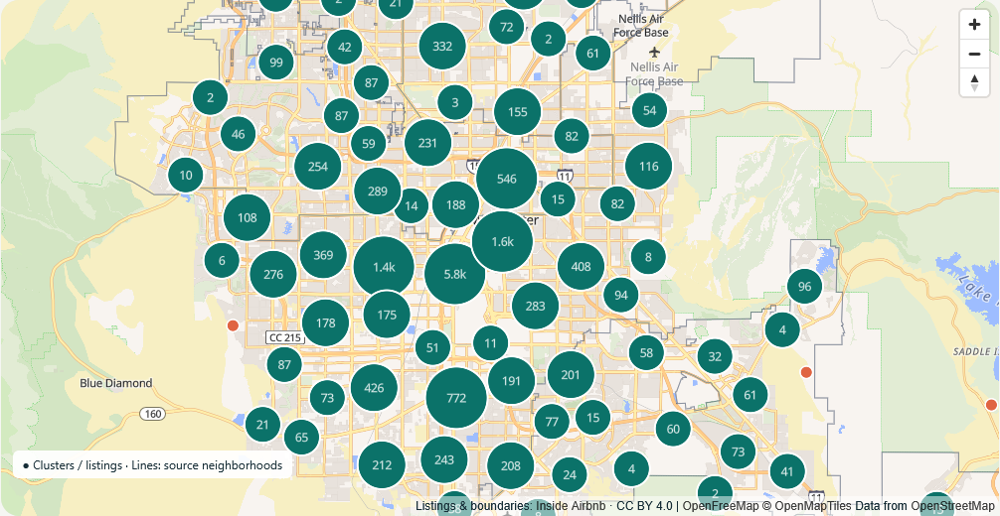

# Las Vegas STR Explorer

An interactive map of advertised short-term rental prices in the Las Vegas Valley, with a separate four-market ML study behind it. I built this to show the whole process: verify a real dataset, make a useful explorer, test simple baselines before more complex models, and show where the models fail.

[Explore the map](https://str.housev.dev/) · [Research case study](https://str.housev.dev/research/) · [Model card](docs/model-card.md) · [Source and methods](docs/data-sources.md)



*The Las Vegas map in an October 2026 local production preview. Its September 2026 release has 17,212 validated listings.*

## What you can explore

The public map lets you filter by room type, bedrooms, source neighborhood, asking price and approximate Census ZIP area. The map, counts, medians and keyboard-friendly listing browser all use the same filtered sample. If map tiles or WebGL fail, the listing browser still works.

Try [the map](https://str.housev.dev/) and choose **City of Henderson** to inspect that sample. Reset the filters, then try **Entire home/apt**, **4 bedrooms** and ZIP area **89146**. The ZIP filter includes a boundary-sensitivity option because listing coordinates are approximate.

## The research question

**Can a model trained on Airbnb listing characteristics predict advertised nightly prices in a different part of a city—or in a different city?**

The study uses pinned Inside Airbnb snapshots for Clark County, New York City, Los Angeles and Nashville. Of 104,483 source rows, 82,868 had a usable advertised price and coordinates. Missing prices vary sharply by market, so the study reports who entered the modeling sample instead of treating the four files as interchangeable.

We compared a global median, a room-type median, Ridge regression and histogram gradient boosting. Preprocessing was fit only on training rows. Listing IDs were grouped, 3 km geographic blocks were held out, and a 1 km observed-point buffer separated training from evaluation. We also tested fixed models with one city left out and with a small amount of local training data. A separate **development-only** experiment classified listings above or below each market's training-derived median asking price.

The older Clark County snapshot had already informed earlier model work. Its results are historical/development evidence; **New York City, Los Angeles and Nashville supplied the new frozen final test blocks**.

## What we found

On 8,568 newly held-out listings across those three markets:

| Pooled method | Mean absolute error | Root mean squared error |
| --- | ---: | ---: |
| Global training median | $197.84 | $480.72 |
| Room-type training median | $176.46 | $473.21 |
| Ridge | $149.83 | $433.03 |
| Histogram gradient boosting | **$144.11** | **$413.58** |

Boosting improved the overall error, but **the hotel-room subgroup got worse**: $229.94 MAE versus $201.20 for the room-type median (60 listings). The $250–499 asking-price band also regressed. Ridge showed severe tail instability when Nashville was left out of training. These are reasons to keep public price predictions off the map, not details to hide behind the overall average.

The price-segment experiment showed that nonlinear methods do not win everywhere. Random forest macro F1 was 0.773 in NYC, 0.734 in Nashville and 0.780 in LA; logistic regression was slightly better in LA. Those scores are **development-fold diagnostics**, not a fresh final test or an investment label.

The [case-study page](https://str.housev.dev/research/) walks through the comparisons. For exact cohorts, configurations, uncertainty estimates and subgroup errors, see the [model card](docs/model-card.md), [research specification](specs/003-multi-city-research/spec.md) and [aggregate results](specs/003-multi-city-research/final-evaluation.json). The earlier Clark County $123.09 MAE used a different cohort and protocol; it is not a before/after comparison with the four-market result.

## Run it locally

The static explorer and research page use reviewed compact artifacts already in the repository. Running the site does **not** download the full datasets.

```powershell
pnpm --dir web install --frozen-lockfile
pnpm --dir web dev
```

Python research uses the locked environment. CI runs small synthetic fixtures, not full-data training:

```powershell
uv sync --project pipeline --locked
uv run --project pipeline pytest pipeline/tests -q
```

The [reproduction guide](specs/003-multi-city-research/quickstart.md) covers deliberate local source downloads, normalization, split manifests and experiment commands. [CONTRIBUTING.md](CONTRIBUTING.md) lists all checks. The [architecture](docs/architecture.md), [deployment guide](docs/deployment.md) and [verification record](docs/verification.md) explain how the static site reaches Cloudflare Pages and which checks were actually run.

## Data and limits

Source: [Inside Airbnb](https://insideairbnb.com/get-the-data/), September 2026 market snapshots, [CC BY 4.0](https://creativecommons.org/licenses/by/4.0/). Filtering, normalization, splits and analysis are project modifications. Full source tables, host/reviewer details, review text, private research rows and model binaries stay out of GitHub. The site publishes only reviewed explorer fields and aggregate research results. Application code does not yet have a selected redistribution license.

**Advertised price is not realized revenue.** Unavailable calendar nights are not confirmed bookings. Approximate listing points cannot identify a property, prove legal eligibility or support an investment ranking. The [roadmap](docs/scope.md) tracks acquisition-cost evidence, temporal validation and any future prediction release separately. Development is tracked through [issues](https://github.com/kenner1-unlv/vegas-str-ml/issues) and [focused PRs](https://github.com/kenner1-unlv/vegas-str-ml/pulls).
